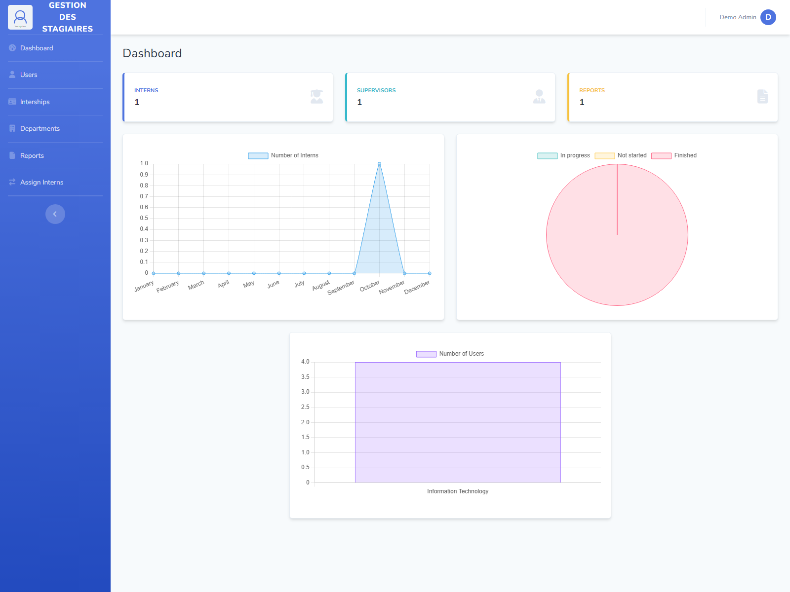
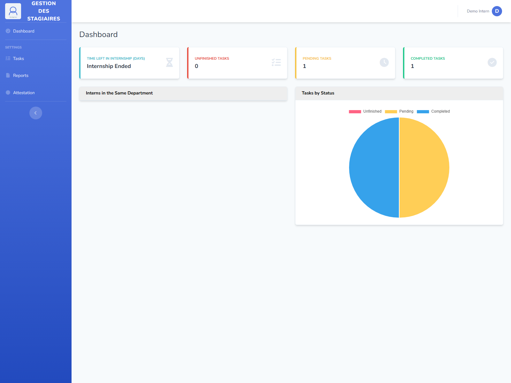
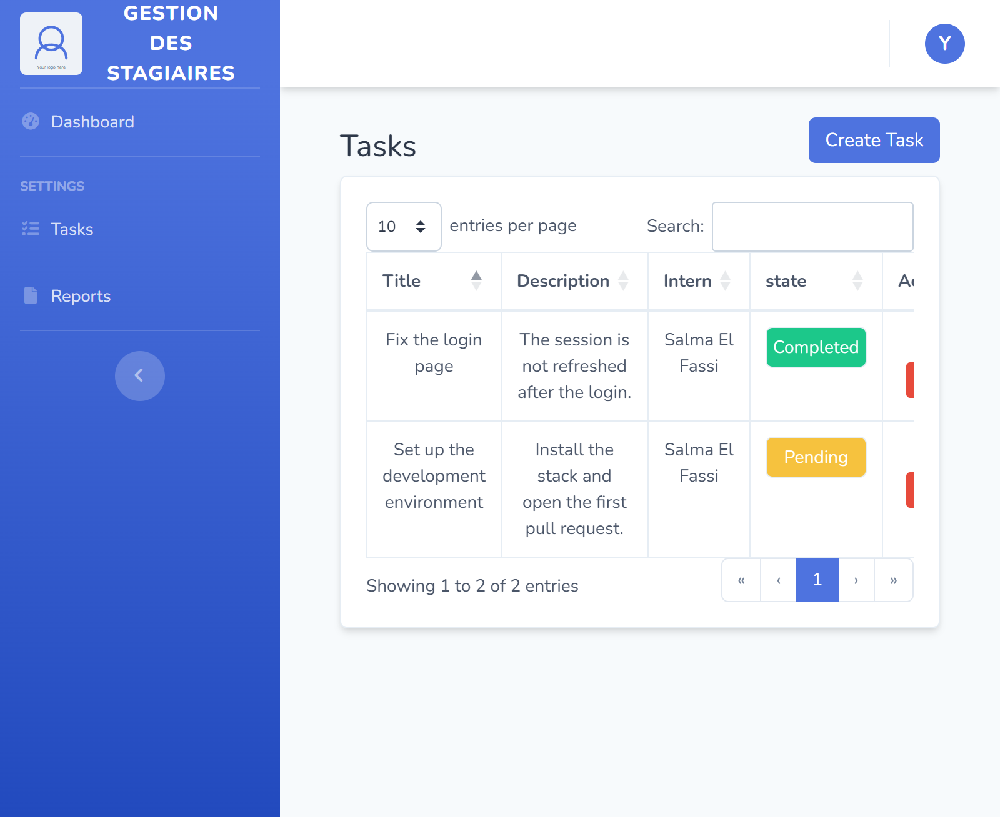
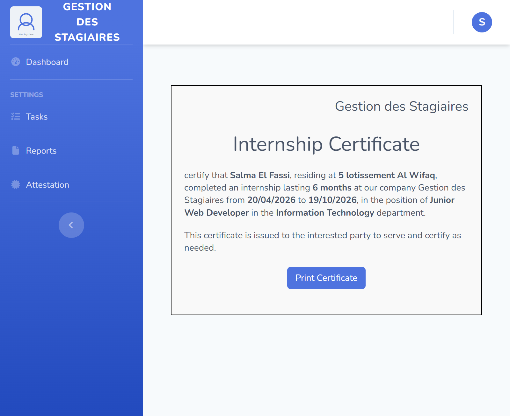
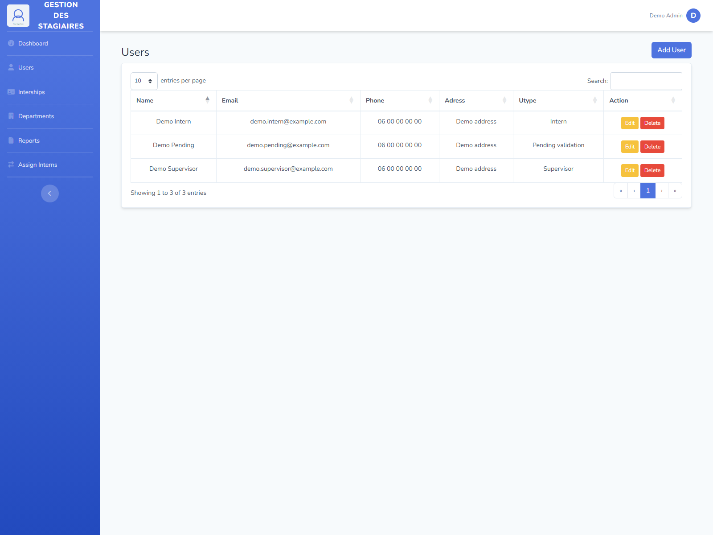
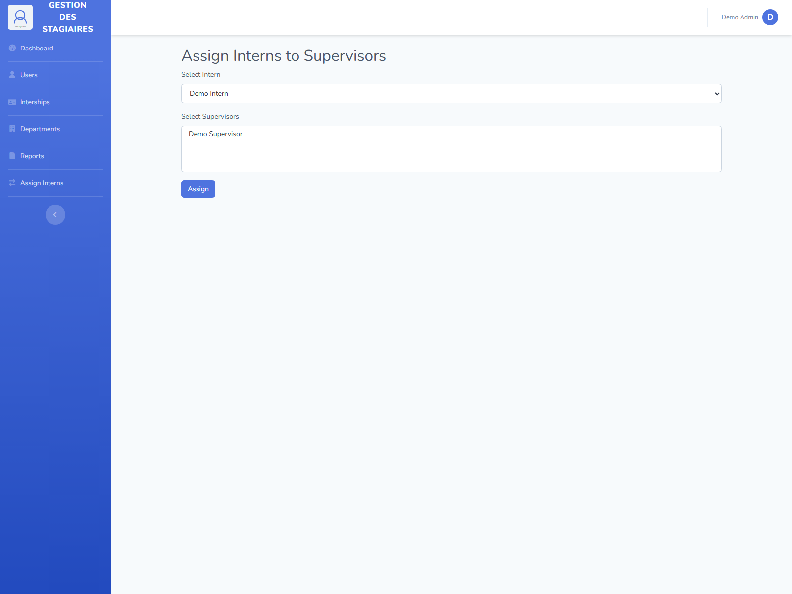
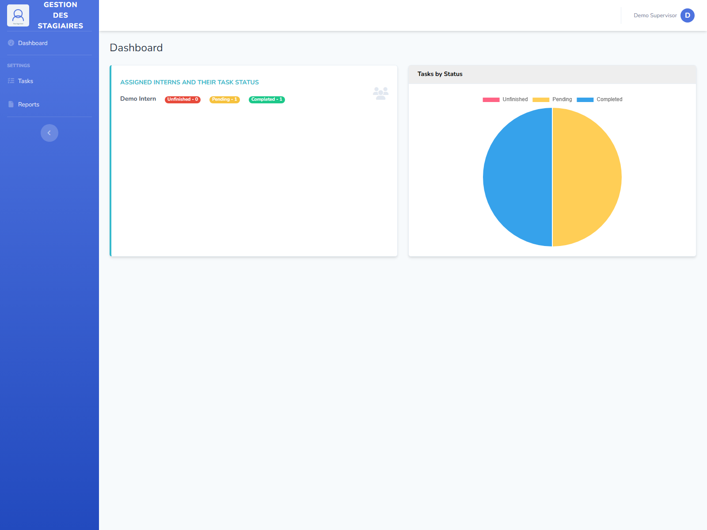
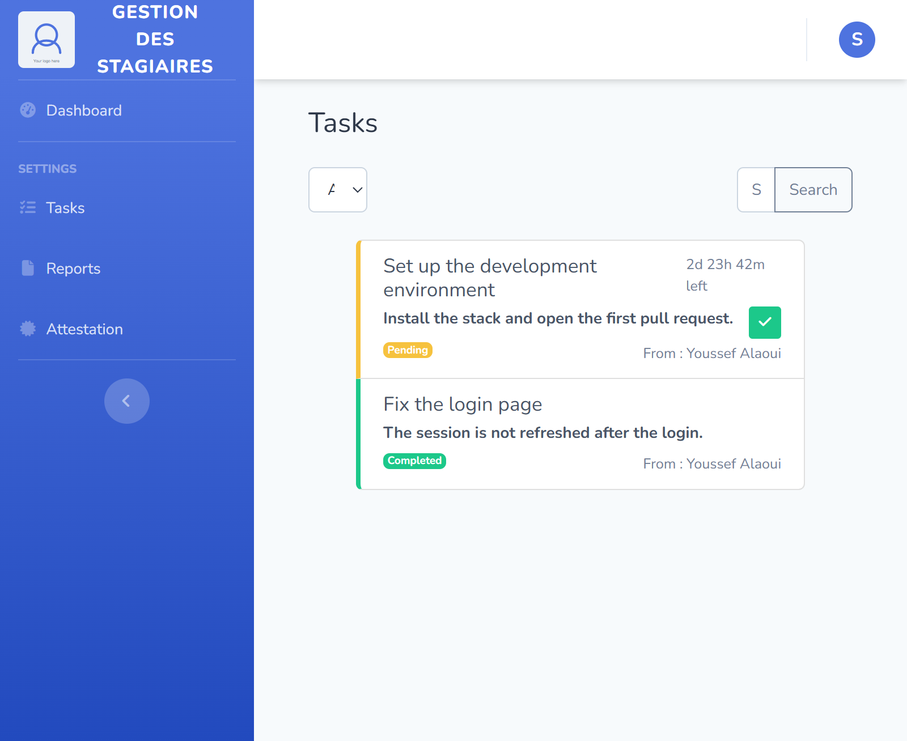

<h1 align="center">🎓 Gestion des Stagiaires</h1>

<p align="center">
  <strong>Internship management platform</strong><br>
  assign interns to supervisors, track their tasks, collect their reports<br>
  and print their end-of-internship certificate.
</p>

<p align="center">
  <a href="https://laravel.com"></a>
  <a href="https://php.net"></a>
  <a href="tests"></a>
  <a href="composer.json"></a>
  <a href="LICENSE"></a>
</p>

<p align="center">
  <code>composer install</code> → <code>php artisan migrate --seed</code> → <code>php artisan serve</code><br>
  <strong>No Node.js, no build step.</strong>
</p>

---

## 📸 Preview

<table>
<tr>
<td width="50%"></td>
<td width="50%"></td>
</tr>
<tr>
<td align="center"><b>Administrator dashboard</b><br><sub>counters + three charts</sub></td>
<td align="center"><b>Intern dashboard</b><br><sub>tasks, deadline and team</sub></td>
</tr>
<tr>
<td width="50%"></td>
<td width="50%"></td>
</tr>
<tr>
<td align="center"><b>Supervisor tasks</b><br><sub>create, edit, delete</sub></td>
<td align="center"><b>Internship certificate</b><br><sub>printable, fully configurable</sub></td>
</tr>
</table>

<details>
<summary><b>More screenshots</b></summary>

<table>
<tr>
<td width="50%"></td>
<td width="50%"></td>
</tr>
<tr>
<td width="50%"></td>
<td width="50%"></td>
</tr>
<tr>
<td width="50%"></td>
<td width="50%">&nbsp;</td>
</tr>
</table>

</details>

---

## ✨ Features

### 👨‍💼 Administrator

| | |
|---|---|
| 📊 | Dashboard with counters and three charts (interns per month, internship status, users per department) |
| 👥 | Create, edit and delete accounts (interns, supervisors, administrators) |
| 🏢 | Manage the departments |
| 🔗 | Assign interns to one or several supervisors, filtered by department |
| 📅 | Fill in the internship details (dates, duration, position held) |
| ✅ | Approve or reject final reports, with a reason for the rejection |
| 🗑️ | Bulk-delete the rejected reports |

### 👔 Supervisor

- 📋 Dashboard listing the assigned interns and the state of their tasks
- ✍️ Create, edit and delete tasks, with a deadline
- 📑 Read the weekly reports sent by the interns

### 🎒 Intern

- 📊 Dashboard with the remaining days, the tasks per state and the department team
- ✅ Mark a task as completed — only the tasks that belong to them
- 🔎 Filter the tasks by supervisor and search by keyword
- 📤 Send a weekly or final report (PDF, Word, max. 2 MB)
- 📜 Printable internship certificate, available once the final report is approved

### 🕓 Pending account

Anyone who registers on their own gets a **pending** account: they can sign in
but they do not reach any dashboard until an administrator gives them a role.

### 👤 No account is invented

The installation creates the departments and nothing else. The first
administrator is created by the person who installs the application with
`php artisan app:create-admin`, and the interns and the supervisors are then
added from the interface with their own information.

---

## 🔐 Roles and permissions

The role is stored in the database and read on **every request**, so revoking a
role takes effect immediately instead of waiting for the session to expire.

| Role | Can |
|---|---|
| `admin` | everything |
| `supervisor` | manage their own tasks, read the reports of their interns |
| `intern` | see and complete their own tasks, send their own reports |
| `pending` | nothing, only the "waiting for an administrator" page |

The fine-grained rules live in `App\Policies\TaskPolicy`:

- only the supervisor who created a task may edit or delete it;
- only the intern concerned may mark a task as completed.

---

## 🧰 Tech stack

| Tool | Version / role |
|---|---|
| PHP | 8.2+ |
| Laravel | 12 |
| Eloquent | ORM |
| SQLite / MySQL | database |
| Blade | views (SB Admin 2) |
| Pest | test suite - 95 tests |
| Chart.js | dashboard charts (CDN) |
| DataTables | sortable tables (CDN) |

The application needs **neither Node.js nor a front-end build**: the views use
the static assets of `public/`. `package.json` is kept for a possible future
Tailwind setup but it is not required to run the project.

---

## 🚀 Getting started

### Requirements

- PHP **8.2** or newer, with the extensions `mbstring`, `openssl`, `pdo`,
  `tokenizer`, `xml`, `ctype`, `fileinfo`, `curl`
- [Composer](https://getcomposer.org/)

### Installation

```bash
# 1. Get the project
git clone https://github.com/Idchaoudi-Youssef/gestion-des-stagiaires.git
cd gestion-des-stagiaires

# 2. Install the PHP dependencies
composer install

# 3. Create the configuration file
cp .env.example .env          # Windows: copy .env.example .env

# 4. Generate the application key
php artisan key:generate

# 5. Create the SQLite database
touch database/database.sqlite   # Windows PowerShell: New-Item database\database.sqlite

# 6. Create the tables and the departments
php artisan migrate --seed

# 7. Create your own administrator account
php artisan app:create-admin

# 8. Expose the uploaded files
php artisan storage:link

# 9. Start the server
php artisan serve
```

The application is then available on <http://127.0.0.1:8000>.

### 👤 Your administrator account

The project **ships without any account**: nobody is invented for you. You
decide who the administrator is:

```bash
php artisan app:create-admin
```

The command asks for the name, the email address and the password. You can
also pass them directly:

```bash
php artisan app:create-admin --name="Your Name" --email="you@example.com" --password="a-strong-password"
```

From there you sign in, open **Users → Add User**, and add your interns and
supervisors with their own information.

### 🎭 Optional demo data

If you would rather look around before creating your own accounts, you can
load a set of obviously fake ones:

```bash
php artisan db:seed --class=DemoSeeder
```

| Role | Email | Password |
|---|---|---|
| Administrator | `demo.admin@example.com` | `password` |
| Supervisor | `demo.supervisor@example.com` | `password` |
| Intern | `demo.intern@example.com` | `password` |
| Pending | `demo.pending@example.com` | `password` |

They are named `Demo …` on purpose, and they are **never** created by
`php artisan migrate --seed`.

---

## ⚙️ Configuration

### Database

SQLite by default. For MySQL or MariaDB, uncomment the block in `.env`:

```dotenv
DB_CONNECTION=mysql
DB_HOST=127.0.0.1
DB_PORT=3306
DB_DATABASE=gestion_des_stagiaires
DB_USERNAME=root
DB_PASSWORD=
```

### Company identity

The details printed on the internship certificate and shown in the sidebar are
read from the environment. **Every value is empty by default**: fill them in
your own `.env` file, which is never committed, so no real company data ends
up in the repository.

```dotenv
COMPANY_NAME=""
COMPANY_CITY=""
COMPANY_PHONE=""
COMPANY_EMAIL=""
COMPANY_SIRET=""
COMPANY_LOGO="img/logo-placeholder.svg"

SIGNATORY_NAME=""
SIGNATORY_POSITION=""
SIGNATURE_IMAGE=""
```

`COMPANY_LOGO` and `SIGNATURE_IMAGE` are paths of files inside `public/`. A
neutral placeholder (`public/img/logo-placeholder.svg`) is provided: drop your
own logo in `public/` and point the variable at it. Leave `SIGNATURE_IMAGE`
empty to print the certificate without a signature.

---

## ⏰ Scheduled tasks

Two Artisan commands keep the state of the platform up to date:

```bash
php artisan tasks:update-states         # flags the overdue tasks as unfinished
php artisan internships:close-finished  # closes the internships that are over
php artisan schedule:list               # see the schedule
```

They are registered in the Laravel scheduler. To run them automatically, add
this line to the crontab of the server:

```cron
* * * * * cd /path/to/gestion-des-stagiaires && php artisan schedule:run >> /dev/null 2>&1
```

---

## 🧪 Tests

```bash
php artisan test
```

95 tests covering:

- the access rules per role (who can see what);
- the isolation of the tasks of an intern (nobody can complete or search the
  tasks of somebody else);
- the isolation of the tasks of a supervisor;
- the protection of the administrator accounts and the deletion of a department;
- the life cycle of the state of a task and of an internship;
- the submission of the reports and the certificate;
- **a smoke test that opens every page of the application**: a page answering
  with a server error makes the test fail.

The test database is an in-memory SQLite database, created and dropped
automatically. No `.env` file is needed to run the suite.

---

## 📁 Project structure

```
app/
├── Enums/              # UserType, TaskState, InternshipStatus, ReportState, ReportType
├── Console/Commands/   # tasks:update-states, internships:close-finished
├── Http/
│   ├── Controllers/    # Admin, Supervisor, Intern, Dashboard, Profile, Auth
│   ├── Middleware/     # EnsureUserType: the role check
│   └── Requests/       # LoginRequest
├── Models/             # User, Department, Internship, Task, Report, InternSupervisor
├── Policies/           # TaskPolicy
└── Services/           # TaskStateService, InternshipService
config/
├── internship.php      # company and signatory of the certificate
database/
├── factories/          # User, Department, Task, Report, Internship
├── migrations/         # schema of the database
└── seeders/            # demo data
docs/screenshots/       # the images of this README
resources/views/        # Blade views (welcome, auth, admin, supervisor, intern)
routes/
├── web.php             # routes of the application
├── auth.php            # authentication routes
└── console.php         # commands and scheduler
tests/
├── Feature/            # functional tests
└── Unit/               # unit tests of the services
```

---

## 🛡️ Security notes

- The passwords are hashed by the `hashed` cast of the `User` model.
- The files uploaded by the interns are limited to 2 MB and to the `pdf`,
  `doc` and `docx` formats (`mimes:pdf,doc,docx`).
- Every request that changes a data goes through a form protected by `@csrf`
  and by the matching HTTP method (`@method('PUT')`, `@method('DELETE')`).
- The deletion of an account or of a department goes through `DELETE` routes
  protected by the administrator role.
- `composer audit` does not report any known vulnerability on the installed
  dependencies.

---

## 📄 License

MIT — see the [LICENSE](LICENSE) file.
